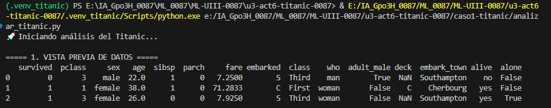
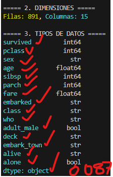
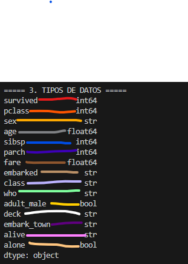
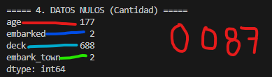
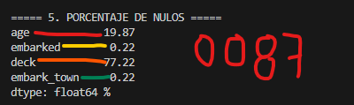
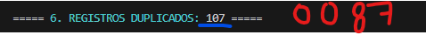
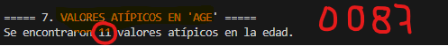
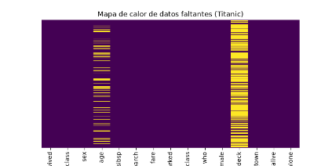
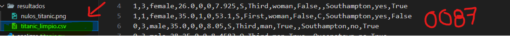

# 🕵️‍♂️ Práctica: Identificación de Problemas en los Datos
## Alonso Lopez Garcia NC = 0087 | Fecha 25/11/2026

## 🎯 Propósito de la Práctica
Que los estudiantes aprendan a revisar conjuntos de datos (*datasets*) e identifiquen los problemas más comunes que pueden arruinar el entrenamiento de un modelo de Machine Learning. 

1. **Caso 1: Pasajeros del Titanic** 🚢 (Detección de problemas reales: nulos, duplicados, tipos y atípicos).

### ===== 1. VISTA PREVIA DE DATOS =====

### ===== 2. DIMENSIONES =====

### ===== 3. TIPOS DE DATOS =====

### ===== 4. DATOS NULOS (Cantidad) =====

### ===== 5. PORCENTAJE DE NULOS =====

### ===== 6. REGISTROS DUPLICADOS =====

### ===== 7. VALORES ATÍPICOS EN 'AGE' =====

### ===== 8. GRAFICA DE NULOS GUARDADA =====

### ===== 9. RESULTADOS GUARDADOS EN CSV NUEVO =====

